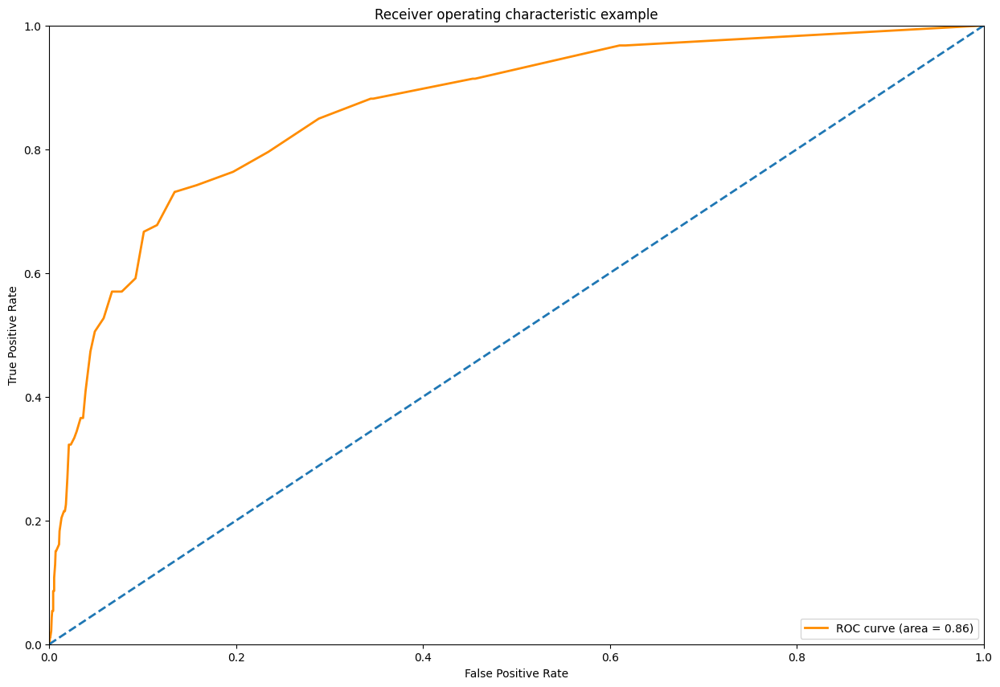
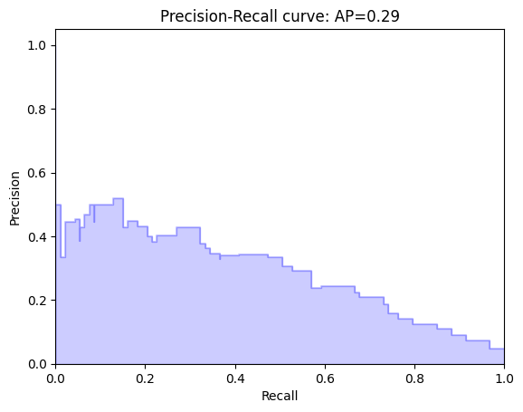
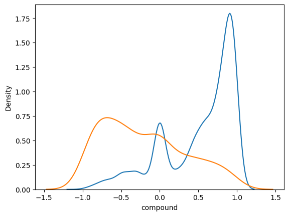
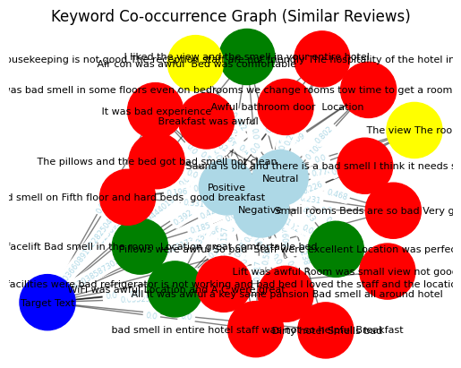

# Hotel review sentiment analysis (Big Data)

Course project for **Management and Visualisation of Large-Scale Data** (Big Data), MSc in Artificial Intelligence & Visual Computing, University of West Attica, June 2023.
Team: **Maria Melina Dolapsaki** and **Vasiliki Manika**.

Online platforms rate hotels by numeric scores and ignore what reviewers actually write. This project uses NLP and sentiment analysis on the text of hotel reviews to (a) detect bad reviews automatically, (b) find reviews that match a specific complaint, and (c) argue for a rating that also reflects review sentiment.

## Data

[515K Hotel Reviews Data in Europe](https://www.kaggle.com/datasets/jiashenliu/515k-hotel-reviews-data-in-europe) (Kaggle): about 515,000 Booking.com reviews of 1,493 luxury hotels across Europe. The CSV (≈240 MB) is not included. Download it from Kaggle and point the notebook at it.

A review is labelled **bad** when the reviewer score is below 5, which gives a heavily imbalanced problem: **4.4 % bad reviews**. Building the co-occurrence matrices on the full set exceeded Colab's memory and took more than 20 minutes, and an SVD reduction did not solve this. So the analysis runs on a random sample of **10,000 reviews**.

## Pipeline

1. **Cleaning (NLTK):** merge the positive and negative parts of each review and drop the "No Negative" / "No Positive" placeholders. Then lowercase, tokenise, remove punctuation, words with digits and stop words, POS-tag with WordNet, and lemmatise.
2. **Sentiment (VADER):** neg / neu / pos / compound scores for every review, plus length features (number of characters and words).
3. **Text representations:** Doc2Vec document vectors (Gensim) and TF-IDF word features.
4. **Classification:** a Random Forest (100 trees) on sentiment, length, Doc2Vec and TF-IDF features, evaluated with ROC and precision-recall on a 20 % test set. The most important features are the VADER compound, pos and neg scores, followed by review length.
5. **Targeted search:** TF-IDF and cosine similarity find the reviews closest to a target complaint (`"bad view awful smell bed"`), then aggregate them per hotel.
6. **Graphs (NetworkX):** keyword and sentiment co-occurrence graphs with greedy-modularity communities, drawn with a spring layout.

## Results

| ROC curve | Precision-recall |
|---|---|
|  |  |

- **ROC AUC = 0.86** for detecting bad reviews.
- **Average precision = 0.29**, against a 0.044 baseline for random guessing. The classifier ranks bad reviews well, but with only 4.4 % positives, precision stays modest. Class re-weighting or resampling would be the next step.
- The VADER compound score separates the classes clearly: good reviews (blue) peak near +1, while bad reviews (orange) spread over negative values.

- **Targeted search:** for the hotel with the most negative reviews, 60 of its 460 reviews closely matched the complaint "bad view, awful smell, bed". Yet the hotel's average score barely reflects them, which is the motivation for a sentiment-aware rating.

## Files

| file | |
|---|---|
| `hotel_reviews_sentiment_analysis.ipynb` | final notebook (Google Colab) |
| `early_exploration.ipynb` | earlier exploratory version |
| `report_big_data.pdf` | project report (in Greek) |
| `figures/` | figures exported from the notebook |

Main libraries: pandas, NLTK (VADER, WordNet), Gensim, scikit-learn, textacy, NetworkX, python-louvain, WordCloud, seaborn.
