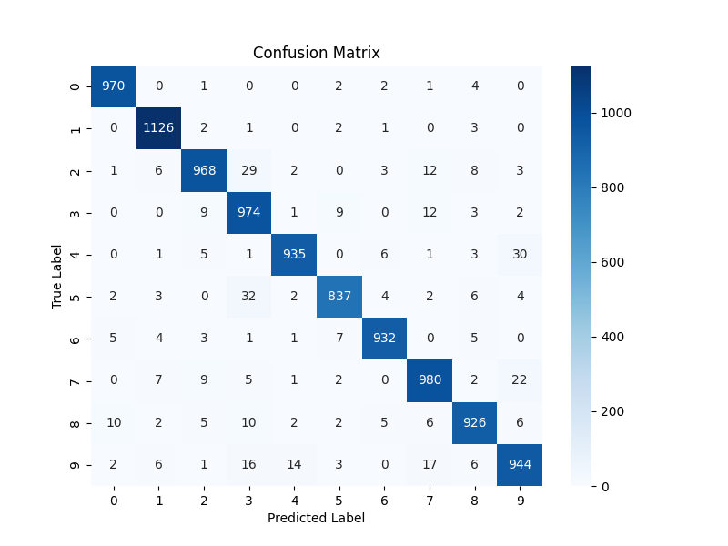
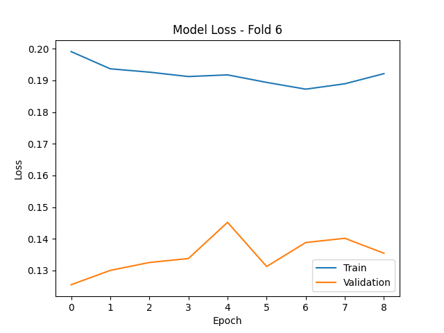
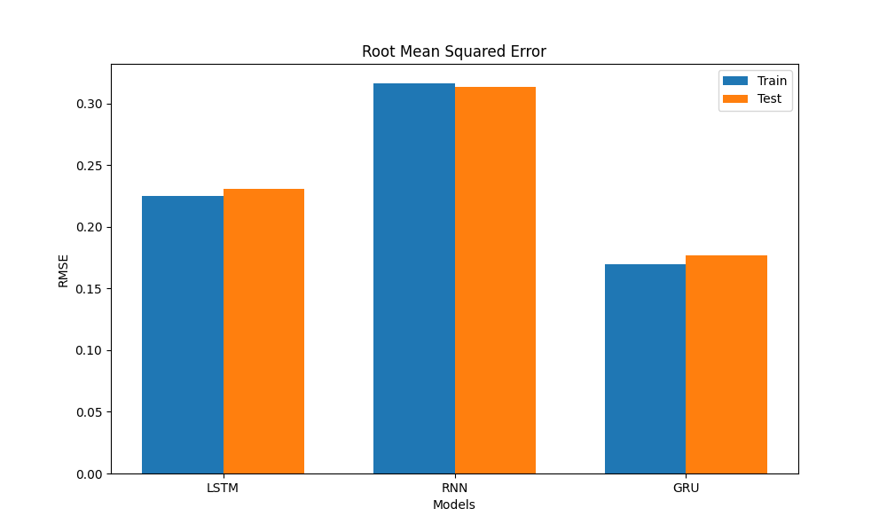
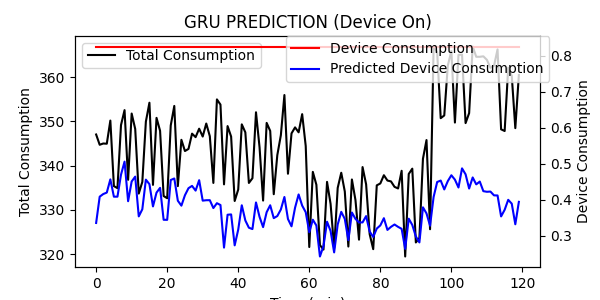

# Deep Learning (July 2023)

Three-part assignment. Python, TensorFlow/Keras, scikit-learn, Google Colab. Reports in Greek.

## 1. Bankruptcy prediction: comparing classifiers · [`1_bankruptcy_prediction/`](1_bankruptcy_prediction/)

Eight classifiers predict company bankruptcy from financial indicators: Logistic Regression, LDA, Decision Tree, k-NN, Naïve Bayes, SVM, an MLP and a custom Keras network. The data is extremely imbalanced: the test set has **22 bankrupt companies out of 1,072**. Training uses a balanced sample (226 bankrupt, 226 healthy), and the comparison focuses on the success rate for each class rather than raw accuracy.

| model (test set) | healthy correctly classified | bankrupt correctly classified (recall) |
|---|---|---|
| Logistic Regression | 75.4 % | 77.3 % |
| LDA | 76.1 % | 81.8 % |
| Decision Tree | 72.7 % | 72.7 % |
| k-NN | 73.3 % | 72.7 % |
| Naïve Bayes | 78.0 % | 72.7 % |
| **SVM** | 71.1 % | **86.4 %** |
| MLP | 71.3 % | 68.2 % |
| custom Keras NN | 67.8 % | 86.4 % |

SVM catches the most bankruptcies while keeping a reasonable rate on healthy companies. Precision for the bankrupt class stays low for every model (≈ 5–7 %), which is expected with only 2 % positives in the test set.

## 2. MNIST: fully-connected network vs CNN · [`2_mnist_dnn_vs_cnn/`](2_mnist_dnn_vs_cnn/)

A feed-forward DNN and a convolutional network classify MNIST handwritten digits, evaluated with 6-fold cross-validation. Loss and AUC curves are plotted for each fold, along with confusion matrices.

| model | test accuracy (mean of 6 folds) | best fold |
|---|---|---|
| DNN | 95.8 % | 95.9 % |
| **CNN** | **97.1 %** | 97.9 % |

 

## 3. Energy disaggregation with RNN, LSTM and GRU · [`3_rnn_energy_disaggregation/`](3_rnn_energy_disaggregation/)

Non-intrusive load monitoring: from 120-minute sequences of a household's **total** power consumption, the models predict the consumption of a single appliance (a coffee machine). SimpleRNN, LSTM and GRU architectures are compared by RMSE, MAE and maximum error, and their predictions are plotted for windows where the device is on and off.

| | RNN | LSTM | GRU |
|---|---|---|---|
| test RMSE (normalised) | 0.31 | 0.23 | **0.18** |

The gated architectures clearly beat the plain RNN, and GRU performs best.

 

